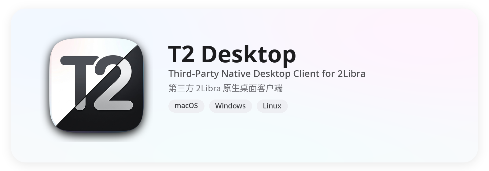

<div align="center">
  <picture>
    <source media="(prefers-color-scheme: dark)" srcset="./T2_Desktop_Banner_Dark.png" />
    <source media="(prefers-color-scheme: light)" srcset="./T2_Desktop_Banner_Light.png" />
    
  </picture>
</div>

# T2 Desktop

> **T2 全称 Third Party 2Libra**（第三方 2Libra）。这是一个由个人开发者
> **vhxubo** 独立开发运营的**非官方**桌面客户端，与 2Libra 无任何隶属、合作或
> 背书关系。2Libra 仅提供账号授权与开放接口，不对本应用的可用性、内容与数据
> 处理负责。

首次启动会弹出一页声明，写明 T2 的全称与上述第三方关系；点「我已了解」后写入
本机配置（`disclaimer.json`），之后不再弹出。随时可在「关于」窗口重看同样的
说明。

基于 [mygo](https://github.com/egoist/mygo) 的原生 UI，用 Go 编写，
支持 Windows / macOS / Linux。界面全部是原生控件：唯一用到 webview 的地方是多账号
时做授权的内置浏览器窗口（见下方「多账号」）。
所有内容数据来自
[2Libra 开放 API v1](https://r2.2libra.com/openapi/v1/index.md)，并严格遵守其
[第三方接入条款](https://r2.2libra.com/openapi/v1/terms.md)（v1.1）。

---

## 第三方声明与条款合规

本项目以 [2Libra 第三方接入条款](https://r2.2libra.com/openapi/v1/terms.md)（v1.1）
为强制约束开发，定位为**独立第三方客户端**。以下为条款要求必须向用户公开、且本应用已落实的内容。

### 与 2Libra 的关系

- 本应用由 **vhxubo** 独立开发运营，**与 2Libra 无隶属或合作关系**，也不是其官方产品。
- 2Libra 仅提供账号授权（OAuth）与开放 API；本应用的功能、质量、可用性、数据安全与内容
  均由开发者自行负责，2Libra 不为此背书或承担任何担保、连带或补充赔偿责任。
- 声明在应用内可见位置（**首次启动声明弹窗**、**登录页**与**「关于」窗口**）始终
  展示，可随时在 2Libra 的「授权应用」页面撤销本应用授权——**撤销后下一个请求即
  失效**，无需改密码。
- 首次启动声明弹窗只出现一次，确认后记在本机；多账号窗口同时打开也只弹一次。

### 品牌与商标

- 不使用 2Libra 的名称、Logo、域名作为本应用的名称、图标、域名或商标；
  本应用包标识为 `com.vhxubo.t2-desktop`。
- 不声称获得 2Libra 的认证、推荐或背书；不注册与 2Libra 近似的回调地址。
- 仅以文字形式表达「使用 2Libra 账号登录」，不会让用户误以为这是官方功能。

### 申请的权限与用途

登录时按最小必要申请以下权限；标「按需」的能力在第一次使用时由应用内的
授权链路补申请。v1 的 scope 名是固定的 9 个，投票与发帖共用 `write:topic`：

| 权限 | 用途 |
| --- | --- |
| `profile` | 读取个人资料与头像 |
| `read` | 读取公开内容（帖子 / 评论 / 节点） |
| `read:me` | 读取我的收藏 / 书签 / 通知等私人内容 |
| `read:economy` | 读取金币余额、流水与签到状态 |
| `write:comment` | 以你的名义发表评论（逐次确认） |
| `interact` | 收藏、表态、关注等互动 |
| `write:topic`（按需） | 发表帖子、参与投票 |
| `write:economy`（按需） | 金币变动：签到 / 打赏 / 佩戴徽章 / 解锁（**需逐项确认，不可逆**） |
| `upload`（按需） | 上传图片到官方图床（仅 Pro 会员与守护者开放） |

> 私有内容（`read:me` / `read:economy`）只用于向你本人提供服务，不会向其他用户披露，
> 也不用于聚合、统计发布或画像。

### 内容与版权

- 应用内展示的 2Libra 用户内容，**版权归原作者所有**；展示时保留作者昵称与原文链接。
- 应用由开发者与 AI 协作完成（Vibe Coding）；社区内容仅由 2Libra 用户提供并原样
  呈现，不代表开发者的思想、观点或意识形态。
- 不批量存档、建立站外镜像、整体转售内容，也不将内容用于训练或微调 AI 模型。
- 以你的名义发布的内容视为你发布的内容，由你本人承担相应责任；应用不会在未经你
  逐次确认的情况下代替你发布内容或静默扣费。

### 数据安全

- 本应用是**公开客户端**（原生桌面端），**不持有 `client_secret`**，仅用 PKCE 完成授权。
- 每个已登录账号的令牌单独一条，保存在**操作系统凭据库**（Windows 凭据管理器 / macOS
  钥匙串 / Linux Secret Service）；凭据库不可用时才退回本机配置文件（权限 `0600`，
  目录 `0700`），并在控制台说明原因。令牌不在日志或崩溃报告中明文外传，也不与第三方共享。
- 撤销授权后，本地保存的令牌与相关数据会及时删除。
- 发现令牌或用户数据泄露时，开发者会按条款在 72 小时内通过条款公布的联系方式告知 2Libra。

完整条款见 [2Libra 第三方接入条款](https://r2.2libra.com/openapi/v1/terms.md)。

---

## 功能特性

- **首次启动声明**：第一次打开应用会弹出 T2 全称（Third Party 2Libra）与第三方
  关系的简短说明，确认后不再打扰；「关于」窗口随时可重看。
- **浏览与无限滚动**：热门、最新、最新评论三个信息流，分页拉取到底自动停止；
  支持按关键词 / 用户 / 节点屏蔽内容，侧栏各分区带未读角标。
- **帖子详情**：Markdown 正文渲染、评论、表情、单选 / 多选投票与结果分布，正文
  内联跳转带返回栈；无权帖按门槛显示访问墙，正文末尾展示金币池状态与兑换码，
  「最后回复」可直接定位到楼底那条评论。
- **媒体预览**：正文与评论里的配图、YouTube / 哔哩哔哩视频链接与裸图片地址进同一组，
  翻页时图片与视频都算一项；gif / apng 逐帧播放，动画 WebP 退回首帧，视频点
  「播放」在浏览器打开原页面。设置里可关闭自动加载图片与动图自动播放。
- **互动**：收藏帖子、给评论加书签（详情与「我的」两处都能删）、把自己的帖子归入或
  移出合集（可直接新建合集；别人的帖子不显示该入口）。
- **登录 2Libra**：浏览器 OAuth（PKCE）+ 自定义协议深链回调；未关联协议时
  可手动粘贴回调链接。
- **多账号**：可以同时挂多个账号，每个账号一个独立主窗口（各自登录、各自收通知），
  启动时只自动打开最近使用的那个账号，其余账号从账号面板随时打开、重新登录或退出；
  未激活账号的未读角标与令牌刷新在后台进行，切换不用重新授权。多账号时每扇窗口
  （通知、设置、金币、发帖……）的标题栏都写明属于哪个账号。
- **浏览器登录**：账号数不超过 1 时，新增账号、重新登录与补权限都直接走系统浏览器；
  本机挂了多个账号时，授权页开在应用内的独立浏览器窗口里（临时会话，不共用系统
  浏览器的登录状态），不用先去网页端退出登录。系统没有 webview 时自动退回系统浏览器。
- **消息中心**：未读角标、SSE 长连接、系统通知与已读批量管理，可按关键词搜索通知；
  多账号时系统通知写明是哪个账号收到的，点开只落到那个账号的窗口。
- **命令中心**：全局命令面板与可配置快捷键，可搜索命令、帖子和用户。
- **金币**：余额、今日明细、流水、统计与排行各自独立加载，未开通的能力只降级
  对应模块；标题栏金币数实时联动，兑换码点开即领。
- **潘多拉**：今日盲盒与抽奖进度。
- **我的与资料卡**：概览 / 内容 / 回复 / 徽章墙 / 六维属性（权限分）五个标签页；
  粉丝与关注两个数字可以点开名单，行内直接回关 / 取关；可换头像（带裁剪）、用
  Markdown 编辑个人介绍；他人资料卡只读展示徽章墙与公开合集。
- **评分榜**：按分数排序、按分类筛选，点一行打开对应帖子。
- **发帖与评论**：独立写帖窗口、独立写评论窗口，帖子 / 动态与回复草稿分开保存，
  还有「稍后再看」清单；帖子可设置登录 / 等级 / D20 属性可见范围与隐藏内容解锁
  门槛（Pro / 打赏 / 属性检定 / 竞拍），作者之后能在编辑窗口改或清除；不选节点时
  由站点 AI 自动分区，详情页显示「节点寻找中…」，分好后自动换成正式节点与原文链接，
  发帖 10 分钟内也能直接改节点；多账号时可临时切换回复身份。
- **图床（图库）**：内置 Imgur / Tikolu / MJJ.Today / ImgBB / Skyimg /
  111666.best / StarDots，官方图床仅对 Pro 会员与守护者开放。
- **搜索与节点**：全文搜索、热门标签、节点级联选择与快捷选择。
- **代理与网络调试**：系统代理与自定义代理（含账号密码、不走代理的域名），所有请求
  统一走代理；内置 DevTools 风格的「网络调试」窗口，记录请求 / 响应头与正文、
  耗时，可筛选并还原成 curl；断网时暂停自动重试。
- **本地缓存**：阅读历史、稍后再看、草稿、已读状态、金币与帖子正文离线缓存，只读写
  本机文件。
- **外观**：浅色 / 深色主题、系统托盘、窗口模式。
- **自动更新**：从 GitHub Release 检查并安装更新，更新包签名校验。

### 暂未接入的能力

开放 API 里标「需开通」的高级能力，除盲盒延期外都已接入：金币池注资、
竞猜参与、兑换码领取、更换头像、受限内容的读取 / 竞拍 / 解锁，以及发帖时
创建隐藏内容（`restricted_*`，含 Pro 可见 / 打赏可见 / D20 属性检定 / 竞拍
可见四种解锁方式）。未开通时只降级对应模块，不会绕过审核。

盲盒延期（`POST /v1/pandora/extend`）暂不实现：文档只列出返回的 `cost` /
`next_cost`，没有给出延期所消耗金币的确定规则；这一步会产生不可逆扣费，
因此等文档补齐规则后再接。

---

## 技术栈

| 项 | 说明 |
| --- | --- |
| 语言 | Go 1.27.3+ |
| UI | `github.com/egoist/mygo` 原生 UI 包 `ui` + `lobe-mygo` 组件；仅多账号授权页放进内置浏览器窗口 |
| 构建工具 | `mygo`（`go tool mygo build`） |
| 网络 | `golang.org/x/net` |
| 包标识 | `com.vhxubo.t2-desktop` |
| 发布 | GitHub Release（`vhxubo/t2-desktop`），更新包用 Ed25519 私钥签名 |

> mygo 不需要 cgo，构建始终 `CGO_ENABLED=0`，结果可复现，且与 go.mod 无关。

---

## 构建与运行

需要先安装 Go 1.27.3+ 与 mygo 工具（`go install github.com/egoist/mygo/cmd/mygo@latest`，
或依赖 `go.mod` 里的 `tool` 指令，用 `go tool mygo` 调用）。

```bash
# 配置好 MYGO_UPDATER_PRIVATE_KEY 后（本地构建可省略，仅影响更新包签名）
go tool mygo build            # 构建当前平台
go tool mygo build -platform "windows/amd64,windows/arm64"  # 交叉编译
go tool mygo build -upload    # 构建并上传到对应 release
```

- 产物输出到 `build/`。
- Windows 安装包由 `packaging/installer.nsh` 钩子扩展。安装和启动均使用普通用户权限，
  不要以管理员身份运行，以免影响截图等桌面快捷键工具。
- macOS 需在 `mygo.json` 配置 `macos.signingIdentity` / `macos.notarize` 才能
  通过 Gatekeeper。

---

## 开发

### 常用命令

```bash
CGO_ENABLED=0 go test ./...     # 跑全部测试
go tool mygo vet .              # mygo 静态检查
gofmt -l .                      # 不应输出任何文件
```

### UI 自动化测试

改 UI 时用 `ui.NewTester` 复现：无头渲染与真实窗口一致，可用 `Find` / `Texts` /
`Image` 断言布局与像素。toast 只在构建期发出，断言前要 `tt.Frame()` 让窗口领走
队列里的提示，再用 `tt.HasText(...)` / `tt.Advance(...)` 验证文案与自动消失。

### Windows 实机截图

在已解锁的 Windows 桌面上，使用同一 Windows 用户先登录 T2 Desktop，再从仓库根目录运行：

```powershell
powershell.exe -NoProfile -ExecutionPolicy Bypass -File .\scripts\capture-windows.ps1
```

脚本复用已运行的窗口，或自动启动本机安装的程序，不读取或复制登录令牌。多账号时用
`-Account '昵称'` 选定主窗口；便携版用 `-ExePath 'D:\Apps\t2-desktop.exe'` 指定程序。
PNG 和 `manifest.json` 默认直接写到仓库的 `docs/images`，不受运行目录影响。
同名文件会更新，未重新捕获的旧 PNG 会保留；以本次 `manifest.json` 为准。
可用 `-OutputDirectory` 改位置。运行时不要同时操作应用，也不要把截图当作界面开发依据。

脚本遍历主导航、设置、通知、搜索、个人中心、关注与粉丝、金币、编辑器等常用界面。
正文、评论、用户资料和媒体预览依赖真实数据；可用 `-TopicTitle '标题前缀'` 选择首页帖子。
没有数据、权限不足或安装版尚无对应入口时，清单会记录跳过原因；`-Strict` 让任何跳过都返回失败。
难以安全触发的状态可先手动打开，再用 `-CurrentWindowsOnly` 捕获当前窗口而不自动导航。

脚本不提交发帖、评论、交易或设置变更；应用仍会照常运行自己的启动任务，并可能记录帖子浏览和命令使用。
截图可能包含账号、通知、草稿、余额或网络日志等隐私信息，分享前请检查并脱敏，不要提交到仓库。

### 约定

- **提交信息只用英文**，遵循 Conventional Commits（`feat` / `fix` / `refactor` /
  `test` / `docs` / `chore`）；中文只允许出现在代码、注释、日志与界面文案里。
- 应用状态里**不要保存** `ui.Element` 或 `*ui.Context`；后台结果通过
  `Window.Update` / `app.publish` 回到 UI 线程。
- 新端点的落地顺序：按文档声明路径与解码 → `httptest` 加测试 → 最后画界面。
- 涉及 2Libra API 的新能力，先读 `AGENTS.md` 里的文档分册对照表；路径、参数名、
  字段名原样照抄，未知字段必须忽略（v1 承诺只增字段）。

更完整的代理约定见 [`AGENTS.md`](./AGENTS.md)。

---

## 项目结构（关键文件）

| 模块 | 主要文件 |
| --- | --- |
| 入口与主窗口 | `main.go`、`app_window.go` |
| 授权 / 令牌 | `auth.go`、`auth_ui.go`、`auth_gate.go`、`login_window.go` |
| 多账号 | `accounts.go`、`accounts_ui.go` |
| 列表与解码 | `api.go`、`rows.go`、`post_read.go`、`rate_limit.go` |
| 帖子详情 | `detail.go`、`detail_ui.go`、`detail_window.go`、`detail_cache.go`、`article_render.go` |
| 媒体预览 | `media.go`、`image_viewer.go`、`animated.go`、`image_source.go`、`image_prefs.go` |
| 发帖 / 动态 / 评论 | `compose.go`、`compose_ui.go`、`compose_title_tag.go`、`compose_suggest.go`、`comments.go`、`reply_view.go`、`reply_window.go`、`reply_identity.go`、`edit.go`、`edit_window.go`、`editor_core.go`、`editor_ui.go` |
| 草稿 / 稍后再看 | `draft.go`、`draft_ui.go`、`watch_later.go`、`watch_later_ui.go` |
| 交互（投票 / 表态 / 关注） | `vote.go`、`interact.go`、`follow.go` |
| 书签 / 合集 | `bookmarks.go`、`collections.go`、`collection_browse.go` |
| 关注与粉丝名单 | `follows.go`、`follows_ui.go` |
| 金币 / 兑换 / 金币池 | `coins.go`、`coins_ui.go`、`coins_window.go`、`redeem.go`、`redeem_history.go`、`reward_pool.go`、`bets.go` |
| 潘多拉 | `pandora.go`、`pandora_ui.go`、`lottery.go` |
| 通知 | `notifications.go`、`notifications_ui.go`、`stream.go`（SSE）、`notify.go` |
| 搜索 / 节点 | `search.go`、`search_ui.go`、`tags.go`、`nodes.go`、`node_catalog.go`、`node_edit.go`、`cascader.go`、`node_filter.go` |
| 个人主页 / 资料卡 | `profile.go`、`profile_ui.go`、`attributes.go`（六维属性）、`badges.go`（徽章墙）、`user_card.go`、`user_card_ui.go`、`about_edit.go`、`avatar.go`、`avatar_crop.go` |
| 评分榜 / Pro 标识 | `scores.go`、`scores_ui.go`、`pro_badge.go`、`account_badge.go` |
| 内容过滤 / 访问门槛 | `content_filter.go`、`content_filter_ui.go`、`restricted.go`、`restricted_ui.go` |
| 图床 / 编辑器上传 | `image_hosts.go`、`image_hosts_adapters.go`、`editor_upload.go` |
| 代理 / 网络调试 | `proxy.go`、`proxy_ui.go`、`netlog.go`、`netlog_ui.go`、`netstatus.go`、`netstatus_ui.go` |
| 主题 / 托盘 / 窗口 | `theme.go`、`theme_ui.go`、`tray.go`、`window_mode.go`、`fabs.go` |
| 命令中心 | `command_registry.go`、`command_palette.go`、`command_builtin.go`、`command_settings.go`、`command_shortcuts.go` |
| 首次启动声明弹窗 | `disclaimer.go`（只弹一次的本地状态）、`disclaimer_ui.go`（Lobe Modal 文案） |
| 本地缓存 | `offline_store.go`、`offline_cache.go`、`image_cache.go`、`reading_history.go` |
| 窗口内提示 | `toasts.go` |
| 发布说明 | `CHANGELOG.md` |

---

## 更新与发布

- 推送形如 `v0.1.0` 的 tag 即触发 [`.github/workflows/release.yml`](./.github/workflows/release.yml)
  的发布流水线：每个平台在各自 runner 上并行构建、签名更新包，上传到同一个
  draft release，全部成功后才自动发布。
- tag **必须**与 `mygo.json` 里的 `version` 一致（预发布版本带 `-beta.1` 之类
  后缀，只发成 prerelease，不占用 `latest`）。
- 构建需要仓库 secret `MYGO_UPDATER_PRIVATE_KEY`（`mygo keygen` 生成的
  `mygo-update.key` 内容），用于签名更新包，与应用 `mygo.json` 里的
  `updates.publicKey` 配对。

---

## 许可

本项目采用 [MIT 许可证](./LICENSE)。
