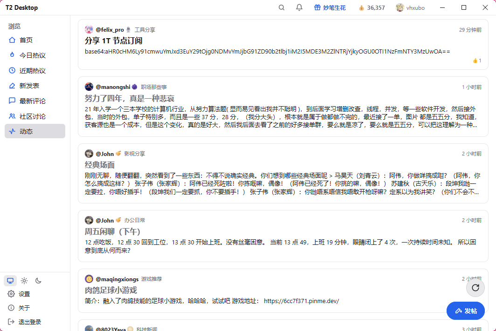
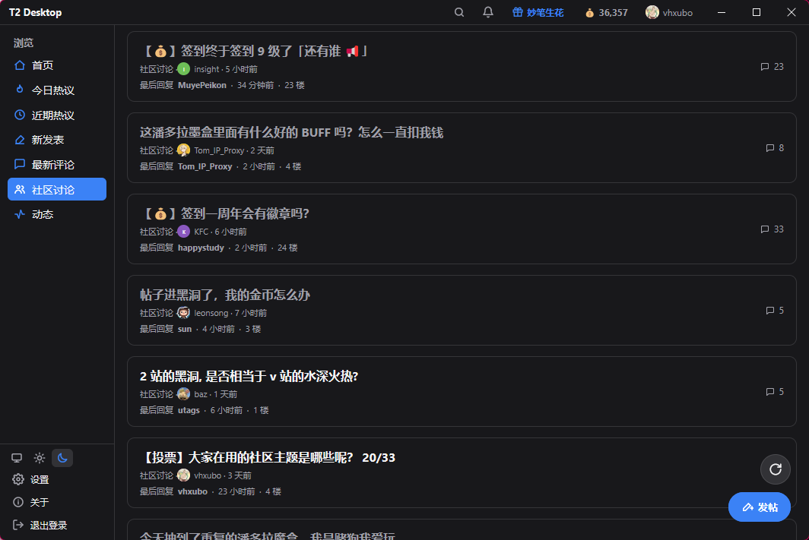
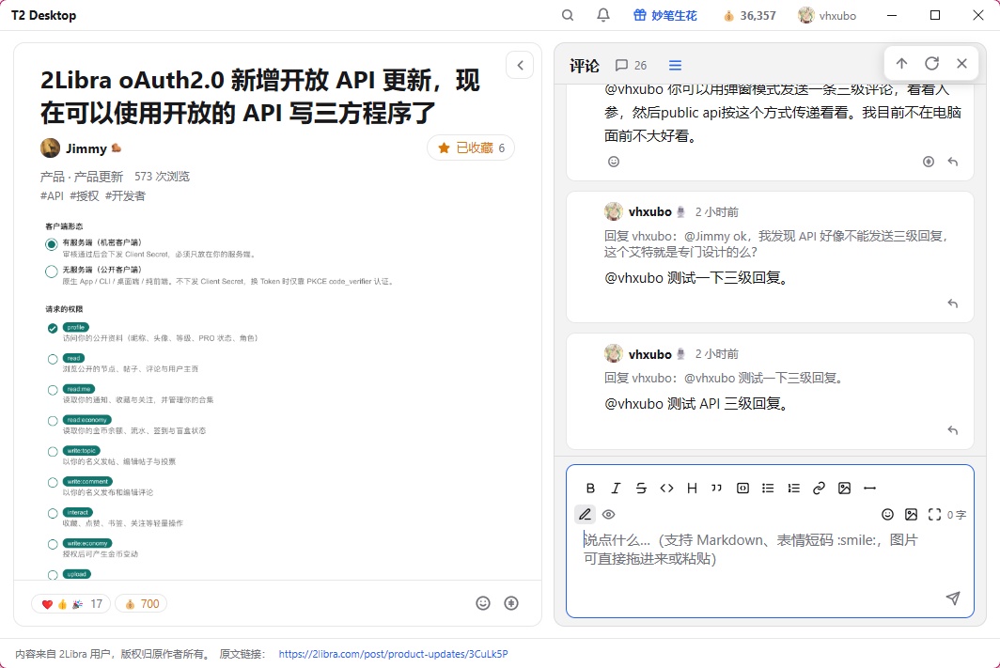
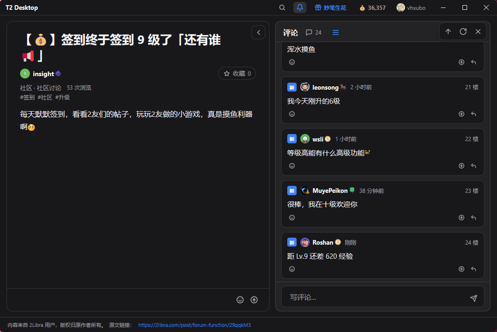
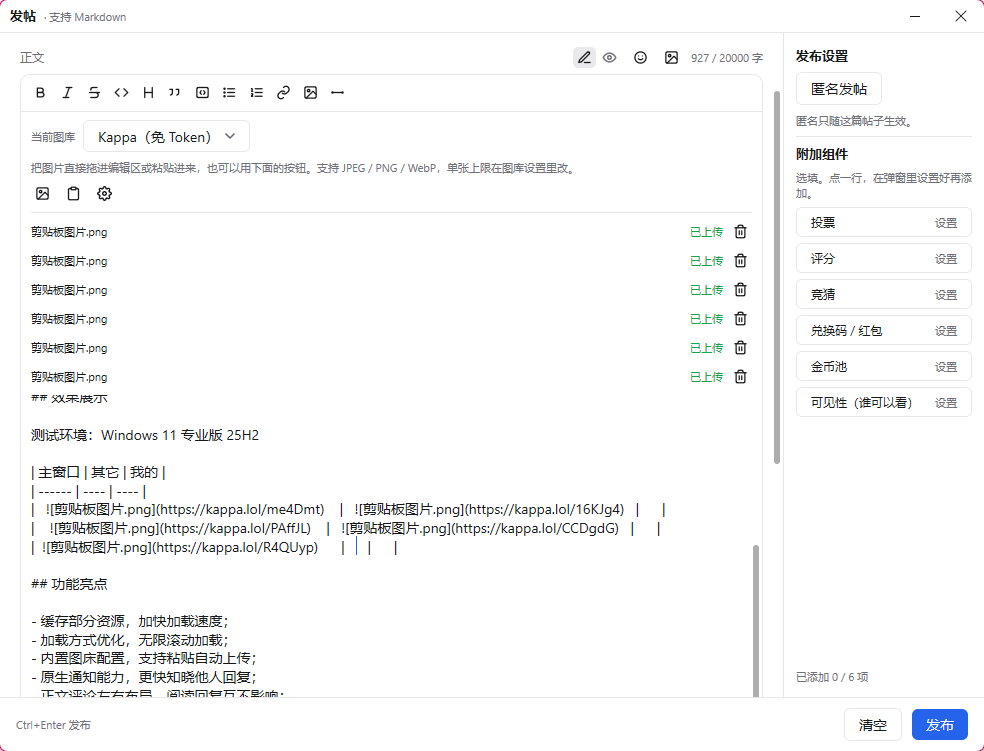
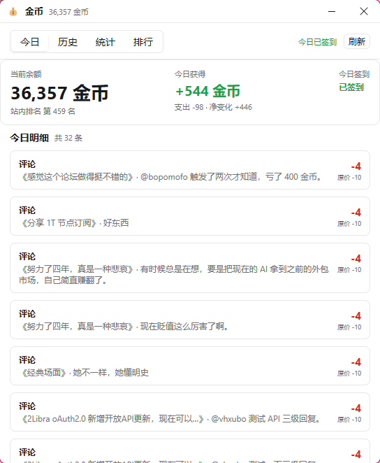
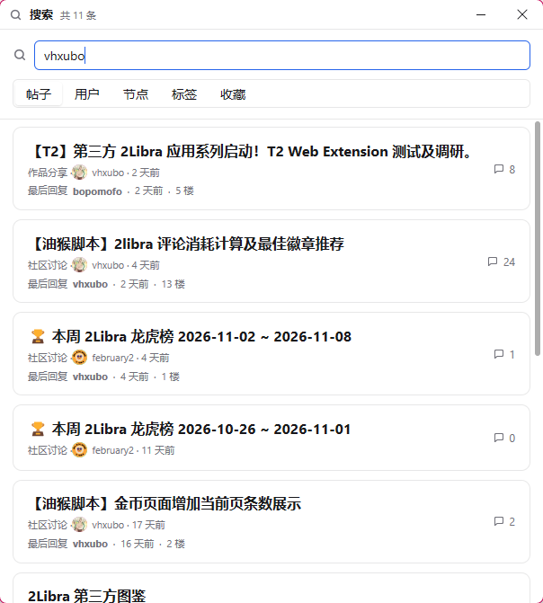
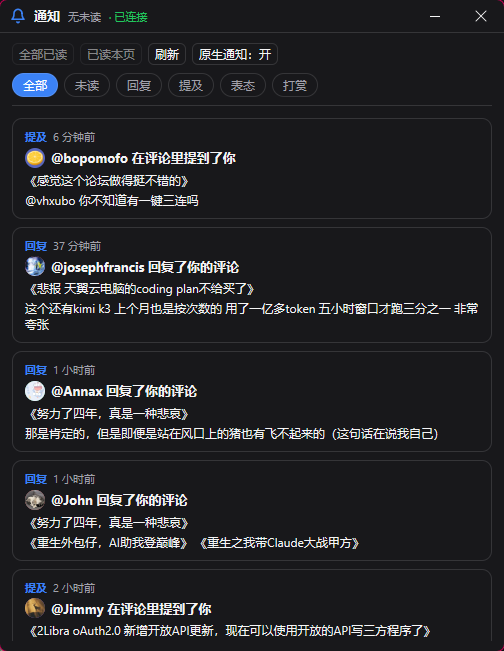

# T2 Desktop

> **第三方应用声明**：T2 Desktop 是由个人开发者 **vhxubo** 独立开发运营的
> **非官方**桌面客户端，与 2Libra 无任何隶属、合作或背书关系。2Libra 仅提供
> 账号授权与开放接口，不对本应用的可用性、内容与数据处理负责。

基于 [mygo](https://github.com/egoist/mygo) 的纯原生 UI（无 WebView），用 Go 编写，
支持 Windows / macOS / Linux。所有内容数据来自
[2Libra 开放 API v1](https://r2.2libra.com/openapi/v1/index.md)，并严格遵守其
[第三方接入条款](https://r2.2libra.com/openapi/v1/terms.md)（v1.1）。

---

## 第三方声明与条款合规

本项目以 [2Libra 第三方接入条款](https://r2.2libra.com/openapi/v1/terms.md)（v1.1）
为强制约束开发，定位为**独立第三方客户端**。以下为条款要求必须向用户公开、且本应用已落实的内容。

### 与 2Libra 的关系

- 本应用由 **vhxubo** 独立开发运营，**与 2Libra 无隶属或合作关系**，也不是其官方产品。
- 2Libra 仅提供账号授权（OAuth）与开放 API；本应用的功能、质量、可用性、数据安全与内容
  均由开发者自行负责，2Libra 不为此背书或承担任何担保、连带或补充赔偿责任。
- 声明在应用内可见位置（**登录页**与**「关于」窗口**）始终展示，可随时在 2Libra 的
  「授权应用」页面撤销本应用授权——**撤销后下一个请求即失效**，无需改密码。

### 品牌与商标

- 不使用 2Libra 的名称、Logo、域名作为本应用的名称、图标、域名或商标；
  本应用包标识为 `com.vhxubo.t2-desktop`。
- 不声称获得 2Libra 的认证、推荐或背书；不注册与 2Libra 近似的回调地址。
- 仅以文字形式表达「使用 2Libra 账号登录」，不会让用户误以为这是官方功能。

### 申请的权限与用途

登录时按最小必要申请以下权限；标「按需」的能力在第一次使用时由应用内的
授权链路补申请。v1 的 scope 名是固定的 9 个，投票与发帖共用 `write:topic`：

| 权限 | 用途 |
| --- | --- |
| `profile` | 读取个人资料与头像 |
| `read` | 读取公开内容（帖子 / 评论 / 节点） |
| `read:me` | 读取我的收藏 / 书签 / 通知等私人内容 |
| `read:economy` | 读取金币余额、流水与签到状态 |
| `write:comment` | 以你的名义发表评论（逐次确认） |
| `interact` | 收藏、表态、关注等互动 |
| `write:topic`（按需） | 发表帖子、参与投票 |
| `write:economy`（按需） | 金币变动：签到 / 打赏 / 佩戴徽章 / 解锁（**需逐项确认，不可逆**） |
| `upload`（按需） | 上传图片到官方图床（仅 Pro 开放） |

> 私有内容（`read:me` / `read:economy`）只用于向你本人提供服务，不会向其他用户披露，
> 也不用于聚合、统计发布或画像。

### 内容与版权

- 应用内展示的 2Libra 用户内容，**版权归原作者所有**；展示时保留作者昵称与原文链接。
- 不批量存档、建立站外镜像、整体转售内容，也不将内容用于训练或微调 AI 模型。
- 以你的名义发布的内容视为你发布的内容，由你本人承担相应责任；应用不会在未经你
  逐次确认的情况下代替你发布内容或静默扣费。

### 数据安全

- 本应用是**公开客户端**（原生桌面端），**不持有 `client_secret`**，仅用 PKCE 完成授权。
- 用户令牌以文件形式保存在本机用户配置目录（目录权限 `0700`），不在日志或崩溃报告中
  明文外传，也不与第三方共享。
- 撤销授权后，本地保存的令牌与相关数据会及时删除。
- 发现令牌或用户数据泄露时，开发者会按条款在 72 小时内通过条款公布的联系方式告知 2Libra。

完整条款见 [2Libra 第三方接入条款](https://r2.2libra.com/openapi/v1/terms.md)。

---

## 功能特性

- **浏览与无限滚动**：热门、最新、最新评论三个信息流，分页拉取到底自动停止。
- **帖子详情**：Markdown 正文渲染、评论、表情、配图，单选 / 多选投票，正文内联跳转带返回栈。
- **登录 2Libra**：浏览器 OAuth（PKCE）+ 自定义协议深链回调；未关联协议时
  可手动粘贴回调链接。
- **消息中心**：未读角标、SSE 长连接、系统通知与已读批量管理。
- **金币**：余额、今日明细、流水、统计与排行各自独立加载，未开通的能力只降级
  对应模块；标题栏金币数实时联动。
- **潘多拉**：今日盲盒与抽奖进度。
- **我的**：概览 / 内容 / 回复 / 徽章墙 / 六维属性（权限分）五个标签页。
- **发帖与评论**：独立写帖窗口、独立写评论窗口，草稿不丢字。
- **图床（图库）**：内置 Imgur / Tikolu / MJJ.Today / ImgBB / Skyimg /
  111666.best / StarDots，官方图床仅对 Pro 开放。
- **搜索与节点**：全文搜索、节点级联选择。
- **代理**：系统代理与自定义代理（含账号密码、不走代理的域名）。
- **本地缓存**：阅读历史、已读状态、金币与帖子正文离线缓存，只读写本机文件。
- **外观**：浅色 / 深色主题、系统托盘、窗口模式。
- **自动更新**：从 GitHub Release 检查并安装更新，更新包签名校验。

### 暂未接入的能力

开放 API 里还有一批标「需开通」的高级能力，默认不授予，接入前需要在应用
申请时说明用途并通过人工审核，因此当前版本没有入口：金币池注资、竞猜参与、
兑换码领取、付费墙解锁、盲盒延期与更换头像。发帖侧的隐藏内容
（`restricted_*`）同样未接入：文档至今只给了「付费 / D20 检定 / 竞拍」的
中文说法，没有 `restricted_access_type` 的机器可读枚举值，猜一个发出去
只会换来 400。这些能力涉及不可逆的金币扣除，不会以「先接上再说」的方式
加入；已接入的签到、盲盒、打赏与徽章佩戴不受影响。

---

## 截图预览

> 以下为不同主题（浅色 / 深色）下的真实界面截图。

| 动态信息流 | 社区讨论 |
| --- | --- |
| <br>**动态**：跨分类的信息流，卡片式帖子列表，右下角悬浮「发帖」入口 | <br>**社区讨论**：节点级信息流，支持投票、回复数与最后回复 |

| 帖子详情（浅色） | 帖子详情（深色） |
| --- | --- |
| <br>**帖子详情**：Markdown 正文渲染、嵌套评论、带 Markdown 工具栏的评论编辑器 | <br>**深色主题**：同一帖子详情，页脚保留「内容来自 2Libra 用户，版权归原作者所有」与原文链接 |

| 发帖窗口 | 金币面板 |
| --- | --- |
| <br>**发帖**：Markdown 编辑器、粘贴/拖拽自动上传图床、匿名发帖与附加组件（投票/竞猜/兑换码/金币池等） | <br>**金币**：余额、今日获得/支出、站内排名、签到状态与今日明细，各自独立加载 |

| 搜索 | 通知中心 |
| --- | --- |
| <br>**搜索**：全文搜索，按帖子 / 用户 / 节点 / 标签 / 收藏分栏筛选 | <br>**通知**：SSE 实时推送，未读角标，按回复 / 提及 / 表态 / 打赏筛选 |

---

## 技术栈

| 项 | 说明 |
| --- | --- |
| 语言 | Go 1.27+ |
| UI | `github.com/egoist/mygo` 原生 UI 包 `ui`（无 WebView） |
| 构建工具 | `mygo`（`go tool mygo build`） |
| 网络 | `golang.org/x/net` |
| 包标识 | `com.vhxubo.t2-desktop` |
| 发布 | GitHub Release（`vhxubo/t2-desktop`），更新包用 Ed25519 私钥签名 |

> mygo 不需要 cgo，构建始终 `CGO_ENABLED=0`，结果可复现，且与 go.mod 无关。

---

## 构建与运行

需要先安装 Go 1.27+ 与 mygo 工具（`go install github.com/egoist/mygo/cmd/mygo@latest`，
或依赖 `go.mod` 里的 `tool` 指令，用 `go tool mygo` 调用）。

```bash
# 配置好 MYGO_UPDATER_PRIVATE_KEY 后（本地构建可省略，仅影响更新包签名）
go tool mygo build            # 构建当前平台
go tool mygo build -platform "windows/amd64,windows/arm64"  # 交叉编译
go tool mygo build -upload    # 构建并上传到对应 release
```

- 产物输出到 `build/`。
- Windows 安装包由 `packaging/installer.nsh` 钩子扩展（安装包需要 UAC 提权，
  应用本身以普通用户运行）。
- macOS 需在 `mygo.json` 配置 `macos.signingIdentity` / `macos.notarize` 才能
  通过 Gatekeeper。

---

## 开发

### 常用命令

```bash
CGO_ENABLED=0 go test ./...     # 跑全部测试
go tool mygo vet .              # mygo 静态检查
gofmt -l .                      # 不应输出任何文件
```

### UI 自动化测试

改 UI 时用 `ui.NewTester` 复现：无头渲染与真实窗口一致，可用 `Find` / `Texts` /
`Image` 断言布局与像素。toast 只在构建期发出，断言前要 `tt.Frame()` 让窗口领走
队列里的提示，再用 `tt.HasText(...)` / `tt.Advance(...)` 验证文案与自动消失。

### 约定

- **提交信息只用英文**，遵循 Conventional Commits（`feat` / `fix` / `refactor` /
  `test` / `docs` / `chore`）；中文只允许出现在代码、注释、日志与界面文案里。
- 应用状态里**不要保存** `ui.Element` 或 `*ui.Context`；后台结果通过
  `Window.Update` / `app.publish` 回到 UI 线程。
- 新端点的落地顺序：按文档声明路径与解码 → `httptest` 加测试 → 最后画界面。
- 涉及 2Libra API 的新能力，先读 `AGENTS.md` 里的文档分册对照表；路径、参数名、
  字段名原样照抄，未知字段必须忽略（v1 承诺只增字段）。

更完整的代理约定见 [`AGENTS.md`](./AGENTS.md)。

---

## 项目结构（关键文件）

| 模块 | 主要文件 |
| --- | --- |
| 入口与主窗口 | `main.go` |
| 授权 / 令牌 | `auth.go`、`auth_ui.go`、`auth_gate.go` |
| 列表与解码 | `api.go`、`rows.go`、`post_read.go` |
| 帖子详情 | `detail.go`、`detail_ui.go`、`detail_cache.go`、`article_render.go` |
| 个人主页 | `profile.go`、`profile_ui.go`、`attributes.go`（六维属性）、`badges.go`（徽章墙） |
| 发帖 / 评论 | `compose.go`、`compose_ui.go`、`comments.go`、`reply_view.go` |
| 交互（投票 / 表态 / 关注） | `vote.go`、`interact.go`、`follow.go` |
| 金币 | `coins.go`、`coins_ui.go`、`coins_window.go`、`coin_events.go`、`coin_cache.go` |
| 潘多拉 | `pandora.go`、`pandora_window.go`、`pandora_ui.go` |
| 通知 | `notifications.go`、`notifications_ui.go`、`stream.go`（SSE） |
| 搜索 / 节点 | `search.go`、`search_ui.go`、`nodes.go`、`cascader.go` |
| 图床 / 编辑器上传 | `image_hosts.go`、`image_hosts_adapters.go`、`editor_upload.go` |
| 代理 / 主题 / 托盘 | `proxy.go`、`theme.go`、`tray.go`、`window_mode.go` |
| 本地缓存 | `offline_store.go`、`offline_cache.go`、`image_cache.go`、`reading_history.go` |
| 窗口内提示 | `toasts.go` |
| 发布说明 | `CHANGELOG.md` |

---

## 更新与发布

- 推送形如 `v0.1.0` 的 tag 即触发 [`.github/workflows/release.yml`](./.github/workflows/release.yml)
  的发布流水线：每个平台在各自 runner 上并行构建、签名更新包，上传到同一个
  draft release，全部成功后才自动发布。
- tag **必须**与 `mygo.json` 里的 `version` 一致（预发布版本带 `-beta.1` 之类
  后缀，只发成 prerelease，不占用 `latest`）。
- 构建需要仓库 secret `MYGO_UPDATER_PRIVATE_KEY`（`mygo keygen` 生成的
  `mygo-update.key` 内容），用于签名更新包，与应用 `mygo.json` 里的
  `updates.publicKey` 配对。

---

## 许可

本项目采用 [MIT 许可证](./LICENSE)。
